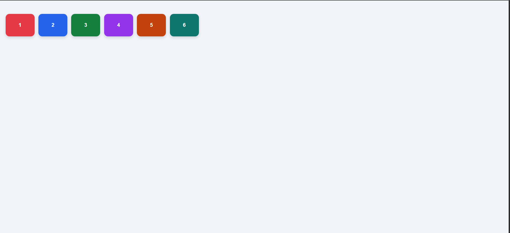
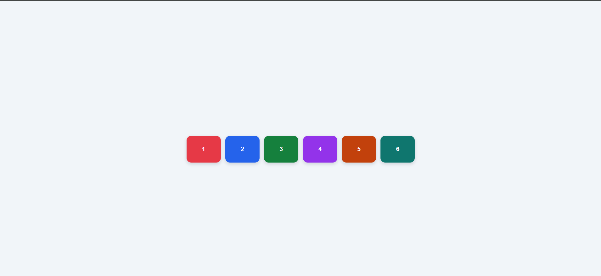
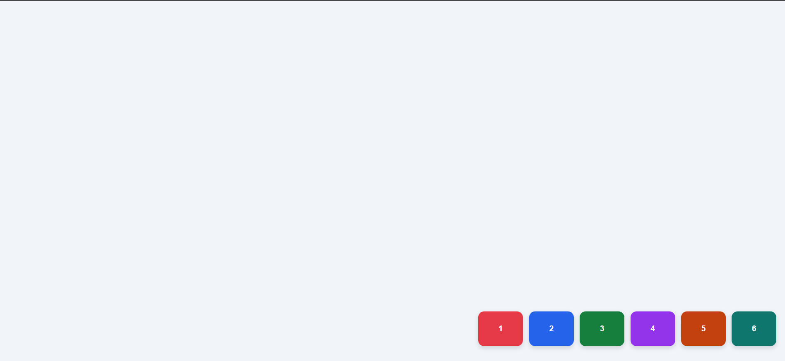

# Week 2 Flexbox Practice: Moving Boxes Around the Screen

**Student Name:** Himbazwe Emerance
**Course:** Advanced Frontend Web Development
**Technologies:** HTML5 and CSS3 only

## Project Description

This project demonstrates CSS Flexbox by moving six differently colored and numbered boxes through nine positions inside a full-screen flex container. The animation uses CSS `@keyframes` and repeats infinitely. No JavaScript is used.

## Files

- `index.html` — Contains the webpage structure and six boxes.
- `style.css` — Contains the styling, Flexbox layout, colors, and animation.

## Flexbox Properties Explained

| Property | Explanation |
|---|---|
| `display: flex` | Makes the container a Flexbox container. |
| `justify-content` | Aligns the boxes horizontally along the main axis when using `flex-direction: row`. |
| `align-items` | Aligns the boxes vertically along the cross axis. |
| `align-content` | Controls the spacing and alignment of multiple flex rows when wrapping is enabled. |
| `flex-direction` | Sets the direction of the flex items. This project uses `row`. |
| `flex-wrap` | Allows the boxes to move onto additional rows when space is insufficient. |
| `gap` | Adds space between the boxes. |
| `@keyframes` | Defines the stages of the animation. |
| `animation-iteration-count: infinite` | Repeats the animation continuously. |

## The Nine Flexbox Positions

The following table shows the main Flexbox values used to create each position.

| No. | Position | `justify-content` | `align-items` |
|---:|---|---|---|
| 1 | Top Left | `flex-start` | `flex-start` |
| 2 | Top Center | `center` | `flex-start` |
| 3 | Top Right | `flex-end` | `flex-start` |
| 4 | Middle Left | `flex-start` | `center` |
| 5 | Center | `center` | `center` |
| 6 | Middle Right | `flex-end` | `center` |
| 7 | Bottom Left | `flex-start` | `flex-end` |
| 8 | Bottom Center | `center` | `flex-end` |
| 9 | Bottom Right | `flex-end` | `flex-end` |

## CSS Animation

The `moveBoxes` animation lasts 27 seconds and repeats infinitely. Its keyframes change `justify-content`, `align-items`, and `align-content` to demonstrate the nine positions.

The container uses `flex-wrap: wrap` to demonstrate an additional Flexbox layout.

## Screenshots

### Screenshots

### 1. Top Left

### 2. Center

### 3. Bottom Right

## Video Demonstration

**Video link:** To be added after recording.

The demonstration video will explain the Flexbox container, the six numbered boxes, the nine positions, and the CSS animation.

## GitHub Repository

**Repository link:** Add your public GitHub repository URL here.

## GitHub Pages

**Live website:** Add your GitHub Pages URL here after publishing.

## Conclusion

This project demonstrates how CSS Flexbox properties can position and align elements in nine different screen positions using CSS animation without JavaScript.
